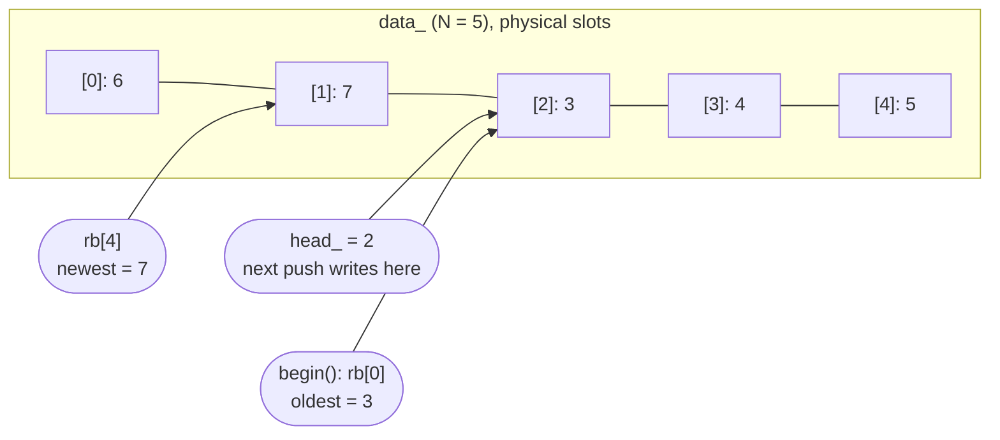

## Ring buffer

`stats::RingBuffer<T, N>` (`stats/include/stats/ring_buffer.hpp`, header-only)

Fixed-size circular buffer backed by `std::array<T, N>`, capacity `N > 0`, element type `T`. No heap allocation.
Holds the last `N` sensor measurements.

- `push()` fills the buffer until it is full, then overwrites the oldest element.
- `operator[](i)`: element `i` in insertion order, `rb[0]` is the oldest. No bounds check.
- `size()`, `capacity()`, `empty()`, `full()`
- `begin()`, `end()`: `ConstIterator` (read-only) in insertion order. `begin()` is the oldest element, `end()` is one past the newest.

`ConstIterator` is a forward iterator (`std::forward_iterator_tag`). It stores a pointer to the buffer and a logical index, and provides `operator*`, `operator->`, `operator++` (prefix/postfix), `operator==`, `operator!=`.

### Layout

The oldest element is not necessarily at array index 0. `head_` is the slot of the next write, `count_` the number of stored elements. Example: `N = 5` after `push(1) ... push(7)`:



Logical index to slot: `rb[0]`=slot 2, `rb[1]`=slot 3, `rb[2]`=slot 4, `rb[3]`=slot 0, `rb[4]`=slot 1.  
`end()` is logical index 5 (`count_`), one past the last element.

Mapping: `slot = (head_ + N - count_ + i) % N`. The `+ N` keeps the unsigned subtraction from wrapping.

### Usage

```cpp
stats::RingBuffer<float, 3> rb;
rb.push(1); rb.push(2); rb.push(3); rb.push(4);
// contents: 2, 3, 4  ->  rb[0] == 2
for (float value : rb) { /* 2, 3, 4 */ }
```


## Filters: MA vs. EWMA vs. median

## Welford and numerical stability

## Fixed-Point (Q16.16)

## Benchmark results
