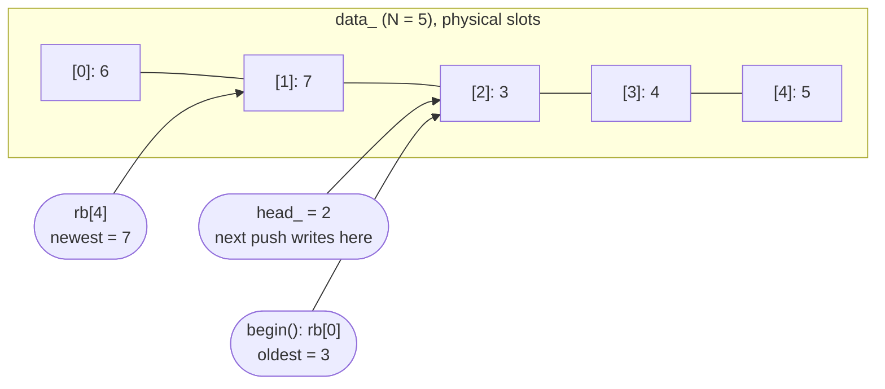

## Ring buffer

`stats::RingBuffer<T, N>` (`stats/include/stats/ring_buffer.hpp`, header-only)

Fixed-size circular buffer on `std::array<T, N>` (`N > 0`), no heap allocation. Holds the last `N` sensor measurements; the oldest is overwritten by the next push.

- `head_`: slot of the next write; `count_`: number of stored elements.
- The oldest element is not necessarily at index 0. `rb[0]` is always the oldest, `rb[count_ - 1]` the newest.
- `ConstIterator` is a forward iterator over the logical order (oldest to newest).

Example: `N = 5` after `push(1) ... push(7)`:



## Filters: MA vs. EWMA vs. median

All three smooth noisy sensor data, but react differently to sudden peaks.

### Moving average

`stats/include/stats/moving_average.hpp`

Arithmetic mean of the last `N` values; all values count equally. An extreme value visibly pulls the average, and real trend changes are followed sluggishly. Stores all `N` values.

$$y_n = \frac{1}{N} \sum_{i=0}^{N-1} x_{n-i}$$

### EWMA

`stats/include/stats/ewma.hpp`

Weighted average where older values count exponentially less. Reacts fast to changes, so a new outlier has a strong influence. Stores only the last filter value.

$$y_n = y_{n-1} + \alpha \, (x_n - y_{n-1})$$

- Fine, even noise, slight delay is acceptable (weather, stock trends).
- Little memory, fast reaction to new trends (microcontrollers, real-time tracking).

### Median

`stats/include/stats/median_filter.hpp`

Middle value of the sorted last `N` values. Implausible outliers are ignored completely, sharp edges in the signal are preserved, short spikes are removed. Stores all `N` values.

$$y_n = \operatorname{median}(x_{n-N+1}, \dots, x_n)$$

- Removing completely implausible outliers (ultrasonic sensors, image processing).

## Welford and numerical stability

`stats/include/stats/welford.hpp`, header-only

Computes mean and variance one sample at a time in O(1) memory, without storing samples.

State: `n`, `mean`, `m2` (sum of squared deviations from the current mean). Per sample `x`:

```
n     += 1
delta  = x - mean
mean  += delta / n
m2    += delta * (x - mean)
```

- Results: `mean`, sample variance `m2 / (n - 1)` (NaN for `n < 2`), population variance `m2 / n`.
- `E[x²] − E[x]²` subtracts two large, nearly equal numbers and loses precision (e.g. data around 1e9). Welford only works with small deltas and stays stable.

In `iot-sim-lab`, the collector keeps a running mean and stddev per sensor stream. Each reading gets `z = (x - mean) / stddev`; if `|z|` exceeds the threshold (e.g. 3), it is flagged as an anomaly (stuck sensor, spike, dropped value). Baseline for "what is normal" on a stationary signal.

## Fixed-point EWMA (Q16.16)

`stats/include/stats/ewma_fixed.hpp`, header-only

Integer-only EWMA, no `float`/`double`. One output per input sample.

$$y_n = y_{n-1} + \alpha \, (x_n - y_{n-1})$$

- Values and alpha are Q16.16 (`int32_t`, LSB = 2^-16, range ±32768).
- alpha in [0, 1.0] (`0 .. 65536`); alpha = 0.25 is `16384`. Out-of-range values are clamped.
- Product in `int64_t`, rounded half up (+0.5 LSB before `>> 16`). No overflow, since the result always lies between `y` and `x`.
- The first sample initializes the state (`y = x`).
- Error vs. the double version is bounded by about 0.5/alpha LSB (see `ewma_fixed_test.cpp`).

Use it on nodes without an FPU (e.g. Cortex-M0/M3) for filtered display or control values. Small alpha: smooth but slow; large alpha: fast but noisy. For mean/stddev in anomaly detection use Welford, not EWMA.

## Benchmarks

`stats/bench/stats_bench.cpp`, built on Google Benchmark

Measures the time per `update()` / `push()` / `add()` call of each filter on 1024 pseudo-random inputs. Used to compare filters (float vs. fixed-point, median vs. moving average) and to catch performance regressions. Absolute numbers are from the host CPU, not an MCU; only the relative differences carry over.

```sh
make bench
build-rel/stats/stats_bench --benchmark_filter=Ewma
```

For stable numbers, set the CPU governor to `performance` first (`sudo cpupower frequency-set -g performance`).

### Results

Host CPU, Release build, governor `performance`.

| Benchmark | Time / call | Items/s |
|---|---|---|
| `BM_RingBufferPush` | 1.98 ns | 505 M/s |
| `BM_EwmaFixed` | 2.37 ns | 422 M/s |
| `BM_EwmaFloat` | 3.88 ns | 258 M/s |
| `BM_MovingAverage16` | 13.2 ns | 76.0 M/s |
| `BM_Welford` | 16.6 ns | 60.3 M/s |
| `BM_ZScoreDetector` | 21.2 ns | 47.2 M/s |
| `BM_MedianFilter5` | 87.4 ns | 11.5 M/s |

- `EwmaFixed` is about 1.6x faster than `Ewma<float>`, even on a CPU with an FPU. On an MCU without FPU the gap should be much larger.
- `MedianFilter<float, 5>` is about 7x slower than `MovingAverage<float, 16>` (sorting on every sample).
- `ZScoreDetector` costs about as much as Welford plus a division and comparison.
